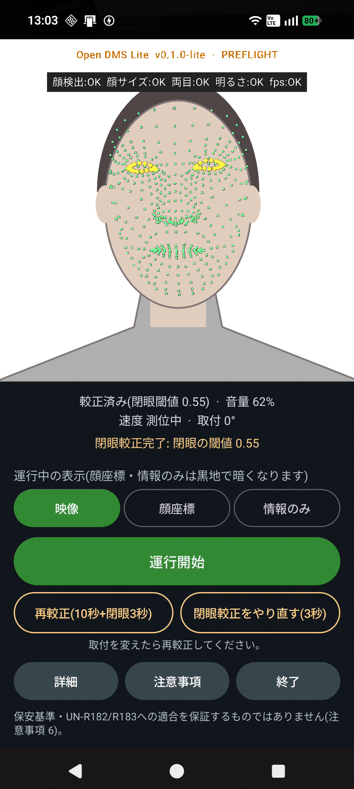
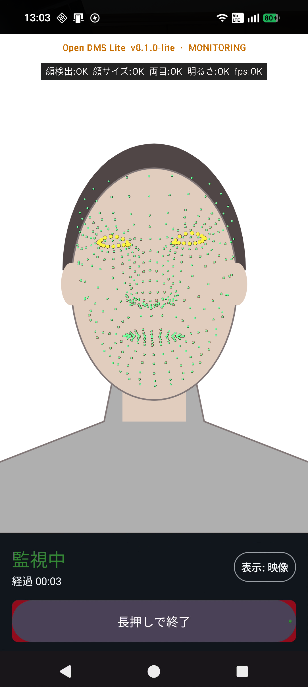
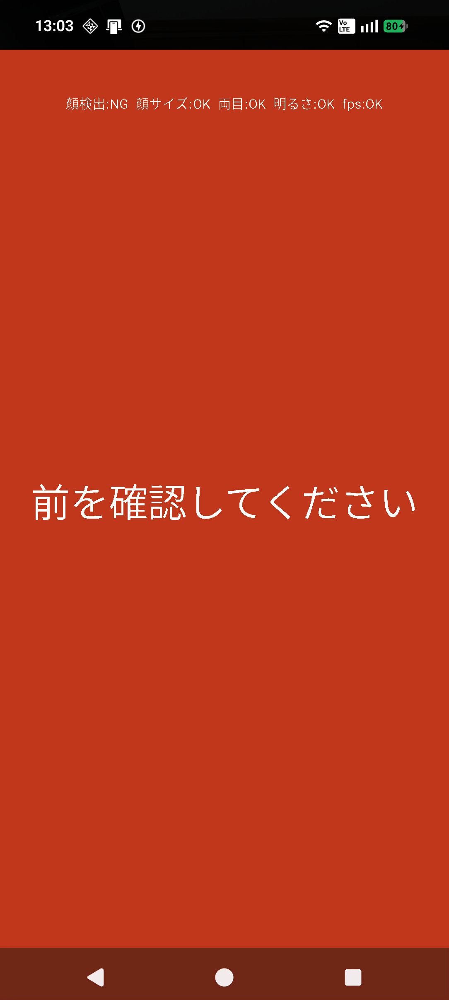

# Open DMS Lite

[](https://github.com/tryproinc/open-dms-lite/actions/workflows/android.yml)
[](LICENSE)

スマートフォンの**インカメラだけ**で、運転者の**眠気の兆候**と**脇見**(前方以外を長く見ていること)を検知し、音・振動・画面で知らせる Android アプリです。無償・オープンソース(MIT License)です。

> **必ずお読みください — [免責事項](DISCLAIMER.md)**
> 保安基準(第43条の11・第43条の12)および UN-R182・UN-R183 への**適合を保証するものではありません**。医療機器ではなく、事故を防げることも保証しません。運転の責任は運転者にあります。

<p>
  
  
  
</p>

画面の顔の部分は人型の絵に置き換えています(実際のアプリにはカメラの映像が映ります)。

## 入手方法

| 方法 | 入手先 |
|---|---|
| Google Play | [Open DMS Lite - 眠気・脇見の見守り](https://play.google.com/store/apps/details?id=jp.co.trypro.opendms.lite) |
| APK を直接入れる | [GitHub Releases](https://github.com/tryproinc/open-dms-lite/releases/latest) または [製品ページ](https://www.trypro.co.jp/product-software/opendms/) |
| ソースからビルド | 下の「[ビルド](#ビルド)」 |

## 何ができるか

| 検知するもの | 知らせる条件(既定) |
|---|---|
| 長く目を閉じている | 1.5秒で注意、2.5秒で強い警告 |
| 頭が前後に揺れる(こっくり) | 12秒の間に5回以上 |
| あくびが続く | 10分の間に3回 |
| 前方以外を長く見ている(脇見) | 6秒(時速50km超は3.5秒)。時速10km未満では鳴らさない |
| 顔が映っていない | 5秒 |
| 監視が止まっている(故障)・端末の高温 | 即時に表示 |

判定の詳細は [仕様書](docs/SPECIFICATION.md)、使い方は [取扱説明書](docs/USER_MANUAL.md)、規格との対応は [対応状況](docs/COMPLIANCE.md) にあります。

## プライバシー

- 解析はすべて端末の中で行います。**ネットワーク通信はしません**(`INTERNET` 権限を持ちません)
- カメラ映像・顔の画像・顔の特徴点は**保存しません**
- 記録するのは、警告の種類・時刻・継続時間・速度などの数値だけです。アプリを削除すると消えます
- 位置情報は速度の判定に使います。許可しなくても監視は続きます。既定では記録しません(設定で「警告が出た地点」だけ記録するよう変えられます)

全文は [プライバシーポリシー](https://www.trypro.co.jp/product-software/opendms/privacy/) を参照してください(原稿: [docs/store/PRIVACY_POLICY.md](docs/store/PRIVACY_POLICY.md))。

## 動作環境と確認状況

- Android 13(API 33)以上、インカメラのある端末(縦向き固定)
- 夜間・暗い場所では検知できません。マスクやサングラスなどでも検知の漏れ・誤報があります([免責事項 §3](DISCLAIMER.md))
- 実機での動作確認: Nothing Phone (2a)、Galaxy A25(SC-53F)、OnePlus 9、Pixel 7、Pixel 7a。**すべての機種での動作は確認していません**
- 保安基準・UN-R182/R183 の試験や、効果の検証は実施していません([対応状況](docs/COMPLIANCE.md))

## このリポジトリの版

| 項目 | 値 |
|---|---|
| 版 | `0.1.0-lite`(`versionCode` 2) |
| アプリ識別子 | `jp.co.trypro.opendms.lite` |
| Google Play の版 | `0.1.0-lite`(最終更新 2026-10-18) |

- 変更の履歴は [CHANGELOG.md](CHANGELOG.md) にあります
- **署名**: Google Play 版と GitHub Releases の APK は、同じ署名(Play アプリ署名)です。署名鍵はこのリポジトリに含まれません。自分でビルドした APK とは署名が違うため、入れ替えるにはアンインストール(記録の消去)が必要です
- **更新**: Android は `versionCode` が小さい版での上書きができません。APK(`versionCode` 2)を入れた端末に、それより小さい版は入りません

## ビルド

必要なもの: JDK 17 以上、Android SDK(compileSdk 36)。

```bash
cd android
./gradlew :app:testDebugUnitTest        # ユニットテスト
./gradlew :app:lintDebug                # Lint
./gradlew :app:assembleDebug            # debug APK(診断CSVを出力)
./gradlew :app:assembleRelease          # 未署名の release APK
```

- 出力: `android/app/build/outputs/apk/{debug,release}/`
- 自分の鍵で署名する場合は、[android/keystore.properties.example](android/keystore.properties.example) を `android/keystore.properties` にコピーして書き換えます(このファイルと鍵は git に入りません)
- 配布する場合は、`applicationId` と表示名を自分のものに変えてください(Google Play で同じ ID は使えません)
- Windows で `app/build` に ReadOnly 属性が付いて Gradle が失敗する場合は、属性だけを外してください

## ソースの構成

`android/app/src/main/java/com/trypro/opendms/` の下:

| パッケージ | 役割 |
|---|---|
| `vision` | MediaPipe による顔の解析、信号品質の判定、故障の監視 |
| `domain` | 較正と眠気・脇見の判定(Android に依存しない Kotlin。閾値は `DayMvpSettings.kt`) |
| `alerts` | 音・振動・画面の警告 |
| `camera` / `location` | インカメラの入力、GPS の速度 |
| `data` | 端末内の記録(Room)、設定(DataStore)、CSV の書き出し |
| `ui` | 画面(Jetpack Compose) |

ソースコメントにある `docs/NN`・`R-NN`・`§14-NN`・`11_DAY_SMARTPHONE_MVP_PLAN.md` などは、非公開の内部資料への参照です。公開版の正は [仕様書](docs/SPECIFICATION.md) です。

## ドキュメント

| 文書 | 内容 |
|---|---|
| [DISCLAIMER.md](DISCLAIMER.md) | 免責事項 |
| [docs/USER_MANUAL.md](docs/USER_MANUAL.md) | 取扱説明書([PDF](docs/Open_DMS_Lite_User_Manual.pdf)・[Word](docs/Open_DMS_Lite_User_Manual.docx)) |
| [docs/SPECIFICATION.md](docs/SPECIFICATION.md) | 検知・発報の仕様書 |
| [docs/COMPLIANCE.md](docs/COMPLIANCE.md) | 保安基準・UN-R182/R183 との対応状況(簡易) |
| [CONTRIBUTING.md](CONTRIBUTING.md) | 不具合報告・開発への参加の手順 |
| [SECURITY.md](SECURITY.md) | 脆弱性の報告先 |
| [THIRD_PARTY_NOTICES.md](THIRD_PARTY_NOTICES.md) | サードパーティのライセンス |
| [tools/](tools/README.md) | 取扱説明書(Word・PDF)の生成手順など |

## Full 版との違い

製品向けの Full 版(非公開・有償)から、次を**ソースごと**取り除いた版です。判定・報知・記録の仕組みは Full 版と同じです。

| 含まない | |
|---|---|
| 外付けカメラ(UVC)・2台構成 | カメラはインカメラ1台だけ |
| 夜間・暗所向けの運用 | 暗い環境では検知できません |

比較は [取扱説明書 §12](docs/USER_MANUAL.md) にあります。

## お問い合わせ・不具合報告

- 不具合・ご意見: [GitHub Issues](https://github.com/tryproinc/open-dms-lite/issues) または info@trypro.co.jp / 042-306-2924。手順は [CONTRIBUTING.md](CONTRIBUTING.md) を参照してください
- **顔の写った画像・動画や、位置情報を含む CSV は Issues に載せないでください**(公開されます)
- Full 版のご相談(導入・運用・提供形態・費用): [製品ページ](https://www.trypro.co.jp/product-software/opendms/) または上記の窓口
- ご報告への返信・修正をお約束するものではありません

## ライセンス

[MIT License](LICENSE) — Copyright (c) 2026 tryproinc。サードパーティは [THIRD_PARTY_NOTICES.md](THIRD_PARTY_NOTICES.md) を参照してください。

---

## English summary

**Open DMS Lite** is a free, open-source (MIT) Android app that uses the **front camera only** to detect drowsiness signs (long eye closure, head nodding, repeated yawning) and long glances away from the road, and alerts the driver with sound, vibration and screen messages.

- **Get it**: [Google Play](https://play.google.com/store/apps/details?id=jp.co.trypro.opendms.lite) or the APK on [GitHub Releases](https://github.com/tryproinc/open-dms-lite/releases/latest). The UI and documentation are in Japanese.
- **Not certified, and no compliance claim**: it does not guarantee compliance with Japan's road vehicle safety standards or UN R182/R183. It is not a medical device and cannot guarantee accident prevention. See [DISCLAIMER.md](DISCLAIMER.md) and [docs/COMPLIANCE.md](docs/COMPLIANCE.md).
- **Privacy**: all analysis runs on the device. No images or facial landmarks are stored, and the app has no INTERNET permission.
- **Requirements**: Android 13+ and a front camera. It does not work in the dark. Tested on Nothing Phone (2a), Galaxy A25, OnePlus 9, Pixel 7 and Pixel 7a; other devices have not been verified.
- **Build**: `cd android && ./gradlew :app:assembleDebug` (JDK 17+, Android SDK 36). Release builds are unsigned unless you provide your own `keystore.properties`.
- **Issues**: please do not post images or videos that show a face, or CSV files that contain locations.

---

© 2026 tryproinc  |  お問い合わせ・不具合報告: info@trypro.co.jp / 042-306-2924
