# Open DMS Lite 取扱説明書

- 版: 0.1.0-lite(2026-11-07 改訂)
- 読む人: 運転者、運行管理者、動作確認をする人
- 発報条件の細部は [仕様書](SPECIFICATION.md) を参照してください
- お問い合わせ・不具合報告は §13 を参照してください

---

## 1. はじめに ── 必ずお読みください

Open DMS Lite は、運転者の**眠気**と**よそ見**(脇見)を、スマートフォンのインカメラで見守り、音・振動・画面で知らせるアプリです。無償・オープンソース(MIT License)です。

**動作の考え方**: このアプリは、眠気そのもの(生理的な眠さ)を測ったり予測したりするものではありません。眠気と同時に起こりやすい体の動き(頭がこっくりと揺れる、目が細くなる・閉じる、あくびが出る)や、よそ見などの行動をカメラで検知して知らせます。検知の考え方は、国連の車両規則 UN R182(運転者の眠気・注意の警報)と UN R183(脇見の警報)を参照しています(規則への適合を示すものではありません)。

- **過信しないでください。** 警告が出ないことは、安全であることを意味しません
- 眠気を感じたら、警告の有無にかかわらず休憩してください
- 運転の責任は、常に運転者にあります
- 医療機器ではありません。健康状態の診断はしません
- 運転中にスマートフォンを操作しないでください。設定は停車中に行ってください
- 警告の閾値は、事故を防げることを保証する値ではありません

### 位置付けと免責

- 本アプリは、道路運送車両の保安基準(第43条の11・第43条の12)および UN-R182・UN-R183 への**適合を保証するものではありません**。型式認証・認定を受けた装置ではありません
- 満たせない項目があります(夜間の動作、車両との連動、運転者による停止の制限、効果検証の未実施など)。項目ごとの対応状況は [対応状況](COMPLIANCE.md) にあります
- 無保証で提供されます。使用または使用できなかったことによる損害について、開発者は責任を負いません(詳細は [免責事項](../DISCLAIMER.md) と [LICENSE](../LICENSE))
- 事業用車両などで従業員に使わせる場合、従業員への説明・労使の取り決め・個人情報の取扱いは、利用者の責任で行ってください

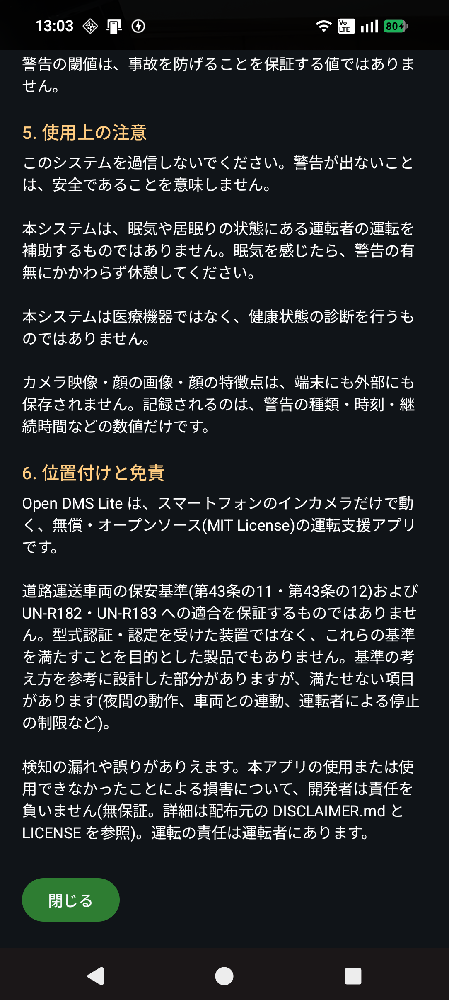

---

<!--pagebreak-->

## 2. 何を知らせるか

| 見ているもの | 知らせる条件(既定) | 画面の文言 |
|---|---|---|
| 長く目を閉じている | 1.5秒で注意、2.5秒で強い警告 | 休憩を検討してください / 安全な場所で休憩してください |
| 頭が前後に揺れる(こっくり) | 12秒の間に5回以上、目が細い状態で | 眠気の兆候があります 休憩してください |
| あくびが続く | 10分の間に3回 | あくびが続いています 休憩を検討してください |
| 前方以外を長く見ている(脇見) | 6秒(時速50km超は3.5秒) | 前を確認してください |
| 顔が映っていない | 5秒 | 顔を確認できません |
| 監視が動いていない(故障) | 映像や解析が止まった | 監視機能が使用できません(赤い帯) |
| 端末が熱い | 運行中に高温になった | 端末が高温です |

- 眠気の検知は**停車中も**動きます
- 脇見は**時速10km未満では鳴りません**(信号待ち・休憩・積卸しで鳴らないように)。ただし前方以外を見ていた時間は止まっている間も数えるので、**見続けたまま走り出すと、時速10kmを越えたところで鳴ります**
- 同じ種類の警告は、一度鳴ると**10秒間は鳴りません**(脇見だけは向きが違えば鳴ります。§6)

---

## 3. 準備

### 3-1. 必要なもの

- Android 13 以上のスマートフォン(インカメラのあるもの)
- 固定用のホルダー(運転席の正面寄り、顔が正面から大きく写る位置)
- 画面を点けたままにするため、給電できるとよいです
- **通信契約の SIM は不要です。** 本アプリはネットワーク通信をせず、オフラインで使えます

外付けカメラには対応していません(夜間・暗所・サングラスの見守りや外付けカメラは、近日リリース予定の Full 版が対応します。§12)。

**スマートフォンをお持ちでない場合・台数分を揃えたい場合**: 弊社で、中古・新品のスマートフォンを 18,000円〜(税別) 各種ご用意しています。設定をしてから納品することもできます。§13 の窓口へお問い合わせください。

### 3-2. インストール

**Google Play から入れるのが簡単です。** Play ストアで「Open DMS Lite」を探してインストールします(https://play.google.com/store/apps/details?id=jp.co.trypro.opendms.lite)。更新も Play ストアから受け取れます。

Google Play を使わない場合は、弊社の製品ページ(https://www.trypro.co.jp/product-software/opendms/)または GitHub(https://github.com/tryproinc/open-dms-lite/releases/latest)から APK ファイル(Android のアプリのファイル)をダウンロードしてインストールします。手順は次のとおりです。

Android 13 以上が必要です。メニューの名前は、メーカーや Android の版によって少し違います(下は代表的な名前です)。見つからないときは、設定の検索で「不明なアプリ」「提供元不明」と入れて探してください。

**1. APK ファイルをスマートフォンに入れる**

- Web からダウンロードする場合: スマートフォンのブラウザ(Chrome など)で開いてダウンロードします。ファイルは「ダウンロード」フォルダに入ります
- パソコンから移す場合: USB ケーブルでつなぎ、スマートフォン側で「ファイル転送」を選んで、「Download」フォルダへコピーします

<!--pagebreak-->

**2. APK を開く**

「ファイル」(または「Files」「マイファイル」)アプリの「ダウンロード」を開き、APK ファイル(`Open DMS Lite…apk`)をタップします。ブラウザでダウンロードした場合は、ダウンロード完了の通知から開くこともできます。

**3. 「提供元不明のアプリ」のインストールを許可する(初回のみ)**

「セキュリティ上の理由から、この提供元からの不明なアプリをインストールすることはできません」などと出たら、

1. 「設定」をタップします
2. 「この提供元のアプリを許可」(または「不明なアプリのインストールを許可」)を ON にします
3. 戻るボタンで戻り、「インストール」をタップします

あらかじめ設定しておく場合は、「設定 → アプリ → 特別なアプリアクセス → 不明なアプリのインストール」で、APK を開くアプリ(「ファイル」や「Chrome」)を許可します。

**4. インストールする**

「このアプリをインストールしますか？」で「インストール」をタップします。終わったら「開く」でアプリが起動します。

- **Google Play プロテクト**の確認(「不明なアプリ」「スキャンするよう求められています」など)が出ることがあります。弊社から受け取った APK であることを確かめたうえで、「詳細」→「インストールする」(または「スキャンせずにインストール」)を選んでください。送信を求められた場合、送るかどうかはお任せします
- インストールが終わったら、手順 3 で許可した「不明なアプリのインストール」は **OFF に戻す**ことをおすすめします(ほかの不明なアプリを誤って入れないため)

<!--pagebreak-->

**5. 更新する(新しい版を入れる)**

新しい APK を同じ手順で開いてインストールすると、上書きされます。較正・設定・運行の記録はそのまま残ります。

- 「アプリはインストールされていません」「既存のパッケージと競合しています」と出る場合は、署名の違う版(開発版など)が入っています。一度アンインストールしてから入れてください。**アンインストールすると、端末に残っている運行の記録・較正・設定は消えます。** 必要な記録は先に CSV で書き出してください(§4-5)
- 入っている版は、前検査の画面の「このアプリについて」で確認できます

**アンインストール**: 「設定 → アプリ → Open DMS Lite → アンインストール」。運行の記録・較正・設定も消えます。

ソースコードは、オープンソースソフトウェア(MIT License)として GitHub で公開しています(https://github.com/tryproinc/open-dms-lite)。

### 3-3. 初回の許可

| 許可 | 使い道 | 許可しないと |
|---|---|---|
| カメラ | 顔を見る | 動きません |
| 位置情報 | **速度だけ**に使う(既定では走行位置を記録しない) | 速度が分からないので、停車中でも脇見の警告が出ることがあります |

### 3-4. 取付

- 顔が**画面の幅の28%以上**に写るようにします。小さいと瞼の開閉が読めず、目を閉じても検知しにくくなります(前検査画面に「顔が小さめです」と出ます)
- **20%を切ると判定が止まり、顔の点が赤くなります。** 画面上部の「顔サイズ」に今の大きさ(%)が出ます。顔が 28% 未満のときは、前検査の画面に「ズーム 1.25倍にする」「1.5倍にする」のボタンが出ます。押すとその場でズームが変わるので、続けて較正し直してください
- カメラを近づけられないときは、**詳細 → カメラ → カメラのズーム**を 1.25倍・1.5倍に上げます。顔が大きく写る代わりに、写る範囲が狭くなります。大きく横を向いたり下を向いたりしても顔が画面からはみ出さない倍率を選んでください。ズームを変えると較正が消えるので、較正し直します
- 逆光・直射日光を避けます
- カメラのレンズを拭いておきます
- 取付を変えたら、必ず**再較正**します

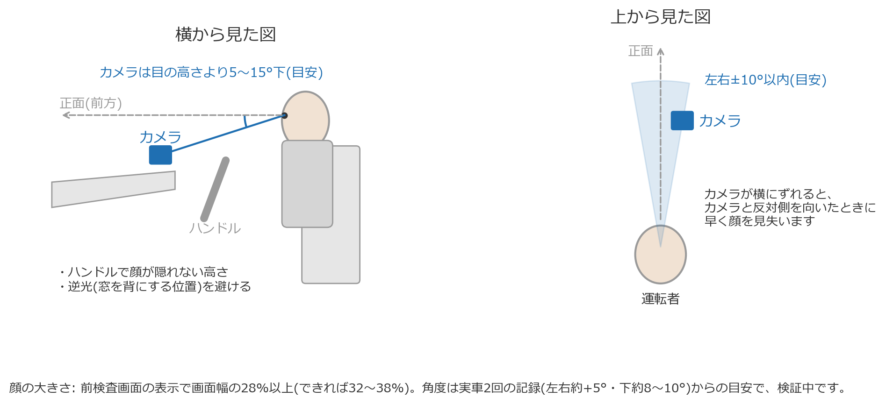

---

<!--pagebreak-->

## 4. 毎回の使い方

### 4-1. 前検査(アプリを開いた画面)

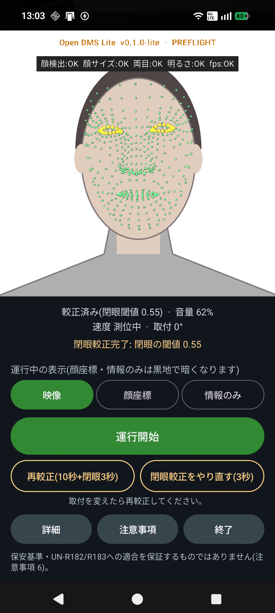

1. 画面上部で次を確認します
   - 較正の状態(「較正済み」)
   - 音量(**30%以上**必要。足りないと「運行開始」が押せません。「警告音を試聴」で確認できます)
   - 速度・取付回転
2. 運行中の表示を選びます
   - **映像**: 普段はこれ
   - **顔座標** / **情報のみ**: 夕方や夜など、画面の明るさを抑えたいとき(黒い画面になります)

### 4-2. 較正(初回・取付を変えたとき・運転者が替わったとき)

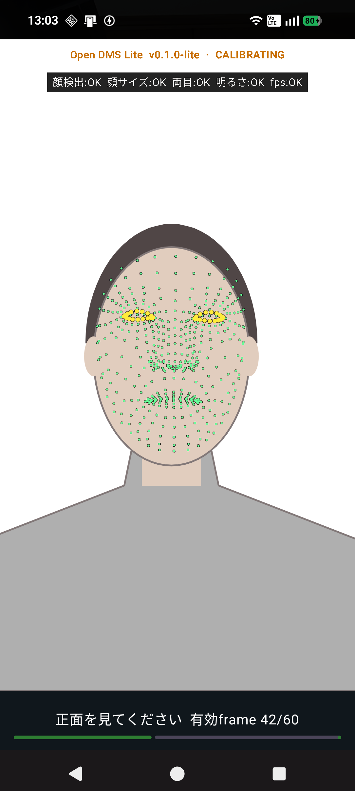

1. 「較正開始(10秒 正面 + 3秒 閉眼)」を押します
2. **10秒間、運転姿勢で正面を見ます**。姿勢と目の開き具合を覚えます。**必ず運転席に座り、運転するときと同じ距離・姿勢で**行ってください(机などで較正してから車で使うと、顔の大きさが違うため正しく判定できません)
3. 合図の音と振動が鳴ったら、**目を閉じます**(3秒。うまく測れないと最大6秒まで延びます)
4. 終わりの合図で目を開けます

- 閉眼の較正だけやり直すときは「閉眼較正をやり直す(3秒)」を押します
- サングラス・マスクで瞼が読めないと失敗することがあります。外して較正してください
- 「取れたが不安定」と出た場合は、閉眼の検知が鈍くなることがあります

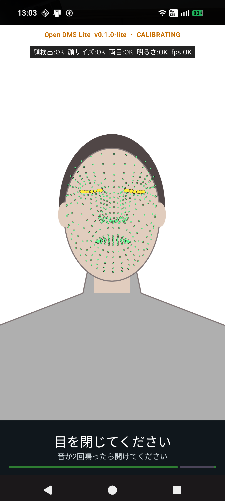

### 4-3. 運行開始

「運行開始」を押します。以後、アプリを**前面に表示したまま**にしてください。

- **一度時速20kmを超えるまで、警告は出ません。** 出発前の準備で手元を見たり動いたりしても鳴らないようにするためです。運行中の画面に「時速20kmを超えると警告を開始します」と出ている間は、警告が出ません。一度20kmを超えたら、その後は止まっても警告を出します。待っている間に始まった脇見や閉眼が20kmを超えた時点でも続いていれば、そこで警告します
- 位置情報を許可していないと、「運行開始」を押したときに許可を促す画面が出ます。「許可する」か「許可しないで使う」を選んでください。「次回から表示しない」にチェックすると、以後は出ません(詳細 → 端末・診断で戻せます)
- 位置情報を許可していない場合と、動作確認モードの間は、運行開始からすぐ警告を出します。位置情報を許可していても、速度が分からない(測位できない・途中で測位が途絶えた)状態が2分続いたら、そこから警告を出します

- 画面を消す、他のアプリを開くと監視が止まります
- 「詳細 → 端末・診断」で「小窓(PiP)を許可」を ON にしておけば、ホームへ戻っても小窓で監視を続けます。警告が出ると自動で全画面に戻ります

<!--pagebreak-->

### 4-4. 運行中

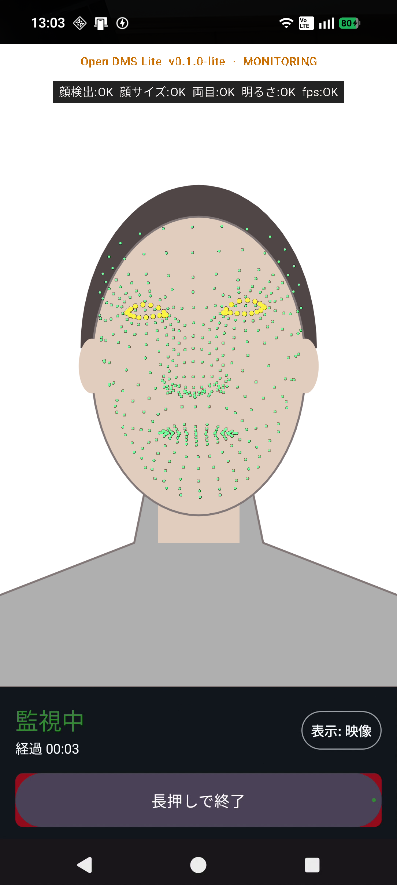

- 何もしなくて構いません。警告は数秒で自動的に消えます(操作は不要です)
- 「動作確認モード」を ON にしていると、紫の帯が常に出ます。**実際の運行では OFF にしてください**

### 4-5. 運行終了

- 戻るボタンを押すと「終了しますか？」と確認が出ます。運行中に「終了する」を選ぶと、運行を終了として記録してからアプリを閉じます

「運行終了」を**2秒長押し**します(誤操作防止のため)。結果画面に、この運行で出た警告の一覧が出ます。
「発報をCSVで書き出す」で一覧をファイルに保存できます。

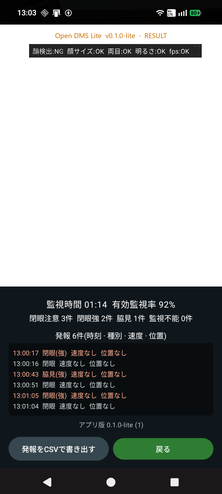

アプリが途中で落ちた・入れ替えられた場合は、次に起動したときに自動で片付けます。警告の記録があれば「中断した運行」として残し、なければ消します。

<!--pagebreak-->

## 5. 警告が出たら

| 画面の文言 | 音 | とるべき行動 |
|---|---|---|
| 休憩を検討してください | 短い音1回 | 目を閉じている時間が長くなっています。休憩できる場所を考えてください |
| 安全な場所で休憩してください | 強い音2回 | 強い眠気の兆候です。安全な場所に停めて休憩してください |
| 眠気の兆候があります 休憩してください | 短い音3回 | 頭が前後に揺れる動きが出ています。休憩してください |
| あくびが続いています 休憩を検討してください | 弱い音1回 | 眠気の初期の兆候です。早めの休憩を考えてください |
| 前を確認してください | 2音 | 前方以外を長く見ています。前に視線を戻してください |
| 顔を確認できません | 低い音1回(10秒ごとに繰り返す) | 顔が映っていません。取付・姿勢・遮るものを確認してください |
| 監視機能が使用できません(赤い帯) | 低い音1回 | 監視が止まっています。安全な場所でアプリを再起動してください |
| 端末が高温です | 低い音1回 | 直射日光を避けるなど、端末を冷やしてください |

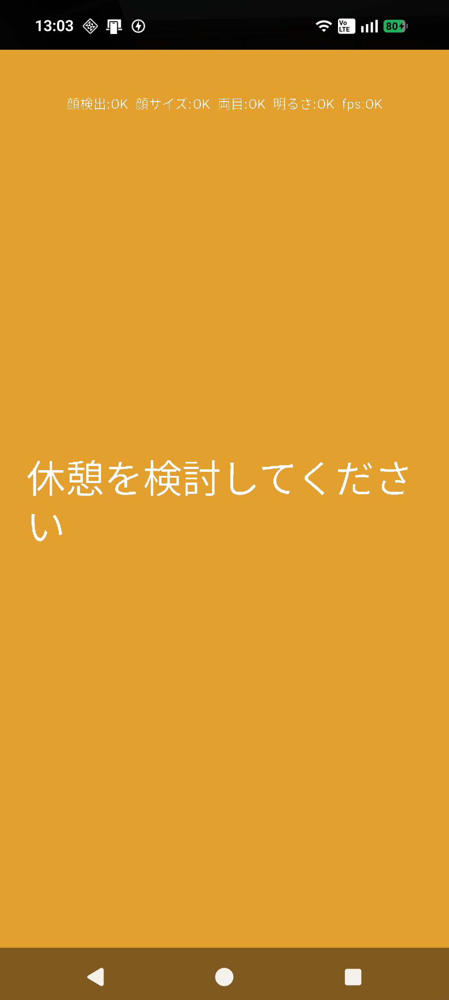

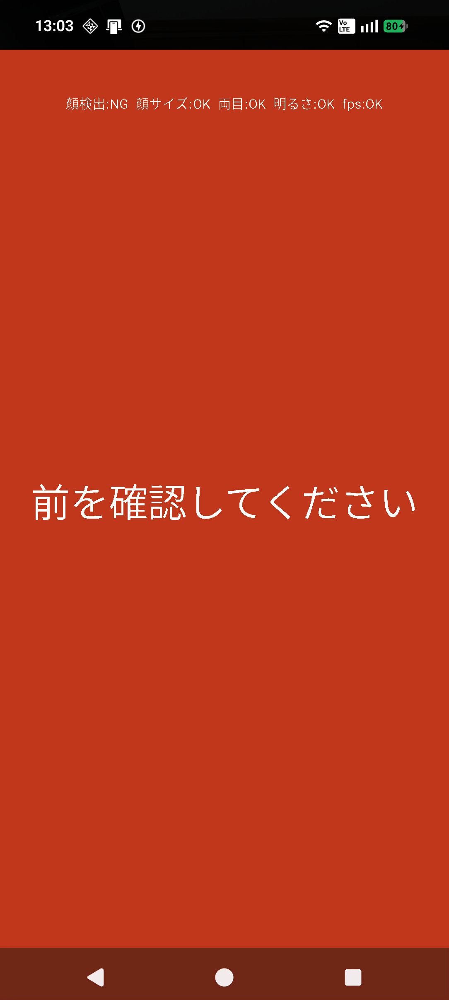

---

## 6. 知っておいてほしい動き

### 6-1. 同じ警告が続けて鳴らないことがある

同じ種類の警告は、一度鳴ると**10秒間**は鳴りません(うるさくなりすぎないため)。

- 例: 目を閉じて警告が鳴り、5秒後にまた目を閉じた → 2回目は鳴りません
- **脇見だけは向きごとに数えます。** 右を見て鳴った直後でも、左を長く見れば鳴ります。同じ右を10秒以内にもう一度長く見ても鳴りません
- 正面に戻らずに左右を見回し続けた場合は、合わせて6秒で鳴ります

### 6-2. 大きく横を向いたとき

大きく横を向いたり、膝や足元など手元を見下ろしたりすると、カメラから顔が見えなくなります。そのときは**顔が消える直前の向き**から、前方以外を見続けているものとして扱い、脇見の警告を出します(15秒まで)。15秒を超えても顔が戻らなければ「顔を確認できません」になります。

停車中(時速10km未満)は脇見が鳴らないので、そのまま「顔を確認できません」になります。

### 6-3. マスク・サングラス

| 装着物 | 影響 |
|---|---|
| マスク | 目を閉じる検知は動きます。**あくびは検知できません。** 横を向くと早めに(約25〜30°で)顔が見えなくなります(脇見は §6-2 で補います) |
| サングラス | 瞼が読めず、目を閉じる検知ができないことがあります。閉眼の較正で失敗・不安定と出ます。Full 版は、外付けの赤外線カメラを使うと、主要メーカーの偏光サングラスに対応済みです(§12。近日リリース予定) |

### 6-4. その他の限界

- **夜間・暗い場所・逆光・トンネルでは、正しく動きません**(Lite は夜間は対象外です。夜間の見守りは、夜間対応カメラ(超高感度センサー または 赤外線LED)に対応する、近日リリース予定の Full 版をご検討ください。§12)
- 下を向くと瞼が下がり、「休憩を検討してください」が出ることがあります
- 上を向く動きは、脇見の警告になりにくいです
- 少し横を向いたまま手で顔を覆うと、脇見の警告が出ることがあります
- 端末が高温になると、精度が落ちます

---

<!--pagebreak-->

## 7. 困ったとき

| 症状 | 考えられる原因と対処 |
|---|---|
| 「運行開始」が押せない | 音量が30%未満です。音量を上げてください。較正が済んでいない場合は較正ボタンだけが出ます |
| 顔の点が赤い | 判定が止まっています。映像の下に、原因と直し方(「顔が小さい → 近づけるかズームを上げる」など)が赤い帯で出ます。画面上部の簡単な表示でも、NG の項目は色が変わります |
| 目を閉じても鳴らない | 顔が小さく写っている(推奨28%以上)/ 閉眼の較正が不安定 / 直前10秒以内に同じ警告が鳴った / 顔が横を向いている。取付を近づけ、較正をやり直してください |
| 脇見が鳴らない | 時速10km未満 / 6秒に届いていない / 同じ向きで10秒以内に鳴った / 上向き。停車中に確かめるときは「動作確認モード」を ON にします |
| 「顔を確認できません」が頻繁に出る | 顔が画角から外れている・暗い・遮るものがある。取付と明るさを確認してください |
| 赤い帯「監視機能が使用できません」 | カメラか解析が止まっています。理由の欄を見て、安全な場所でアプリを再起動してください |
| 画面が消える・監視が止まる | アプリを前面に表示したままにしてください。ホームへ戻っても続けたい場合は、小窓(PiP)を許可します |

### 7-1. よくある質問

**Q. 顔の点が赤くなります。**
A. 判定が止まっています。映像の下に赤い帯で原因と直し方が出ます。画面上部の簡単な表示でも、NG の項目は色が変わります。多いのは「顔が小さい」(カメラを近づけるか、ズームを上げる)と「処理が遅い」(端末を冷やす)です。

**Q. 「顔が小さめです」と出ます。**
A. 顔が画面の幅の 28% 未満です。前検査の画面の「ズーム 1.25倍にする」「1.5倍にする」を押すと大きく写ります。ズームを変えたら較正し直してください。20% を切ると判定が止まります。

**Q. 運行開始したのに警告が出ません。**
A. 一度時速20kmを超えるまで警告は出ません(出発前の準備で鳴らさないため。§4-3)。運行中の画面に「時速20kmを超えると警告を開始します」と出ている間は待っている状態です。ほかに、同じ警告は10秒間は鳴らない(§6-1)、脇見は時速10km未満では鳴らない、という決まりがあります。

**Q. 位置情報を許可しないとどうなりますか。**
A. 速度が分からないため、運行開始からすぐ警告します。停車中(信号待ち・休憩)にも脇見の警告が出ることがあります。運行開始のときに許可を促す画面が出ます。位置は速度の判定に使い、走行の軌跡は記録しません。

**Q. パンを噛んだり話したりすると「あくび」と判定されます。**
A. 口が大きく開いた状態が 1.5秒以上続いたときだけ、あくびとして数えます。口を閉じたまま噛む動きでも、カメラには口が開いたように見えることがあります。

**Q. 下を向いただけで「休憩を検討してください」が出ます。**
A. 下を向くと瞼が下がり、目を閉じたように見えることがあります(§6-4)。

**Q. 「高温」が NG になります。**
A. 運行中に端末の温度が上がったときだけ NG になります。直射日光を避け、充電しながら使う場合は端末を冷やしてください。

**Q. 戻るボタンを押したらどうなりますか。**
A. 「終了しますか？」と確認が出ます。運行中に「終了する」を選ぶと、運行を終了として記録してからアプリを閉じます。

**Q. 画面に数値(yaw など)を出したいです。**
A. 詳細 → 端末・診断の「画面に数値も表示(調査用)」を ON にします。普段は切っておいてください。

**Q. 眠気そのものを測っているのですか。**
A. いいえ。眠気と同時に起こりやすい体の動き(こっくり、目が細くなる・閉じる、あくび)や、よそ見を検知しています(§1)。

**Q. 夜間も使えますか。**
A. インカメラだけを使うので、暗い場所では正しく動きません。夜間の見守りは Full 版(外付けの赤外線対応カメラ)をご検討ください(§12)。

**Q. 不具合を報告するときは。**
A. 前検査の画面の「このアプリについて」に出るバージョンと、起きた時刻・状況をお知らせください(§13)。

---

## 8. 設定

「前検査」画面の「詳細」から開きます。

画面上部に「閾値設定」ボタン、その下に3つのタブがあります。

| タブ | 主な内容 |
|---|---|
| カメラ | 較正、カメラの回転(取付の向き) |
| 判定 | 動作確認モード、警告が出た地点の記録 |
| 端末・診断 | 位置情報の許可、小窓(PiP) |

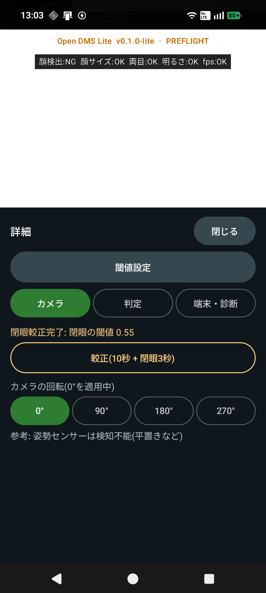

### 8-1. 閾値の変え方

「詳細」上部の「閾値設定」を開き、**スライダー**で調整します。項目は10個だけです。それぞれに、何を変える項目かの説明、いまの値と既定値、「敏感 ↔ 鈍感」の向きが出ます。「保存」で反映、「既定値に戻す」で初期値に戻ります。

| 区分 | 項目 | 既定 | 動かすと |
|---|---|---|---|
| 目を閉じる | 注意まで | 1.5秒 | 短いほど、早く「休憩を検討してください」が出ます |
| 目を閉じる | 強い警告まで | 2.5秒 | 短いほど、早く「安全な場所で休憩してください」が出ます(注意より長くなるよう自動で揃えます) |
| こっくり | 警告に必要な回数 | 5回 | 少ないほど、少ない揺れで警告が出ます |
| あくび | 注意に必要な回数 | 3回 | 少ないほど、早く注意が出ます |
| あくび | 数える期間 | 10分 | 長いほど、回数が溜まりやすく注意が出やすくなります |
| 脇見 | 警告まで | 6秒 | 短いほど、早く「前を確認してください」が出ます(時速50km超は3.5秒、これより短くしたときはそれに揃えます) |
| 脇見 | 横向きの角度 | 25° | 小さいほど、少し横を向いただけで「前方以外を見ている」と数えます |
| 脇見 | 上下向きの角度 | 20° | 小さいほど、少し上下を向いただけで数えます |
| 脇見 | 判定する速度の下限 | 10km/h | 小さいほど、遅い速度でも脇見を判定します |
| 共通 | 同じ警告の間隔 | 10秒 | 短いほど、同じ警告が頻繁に鳴ります |

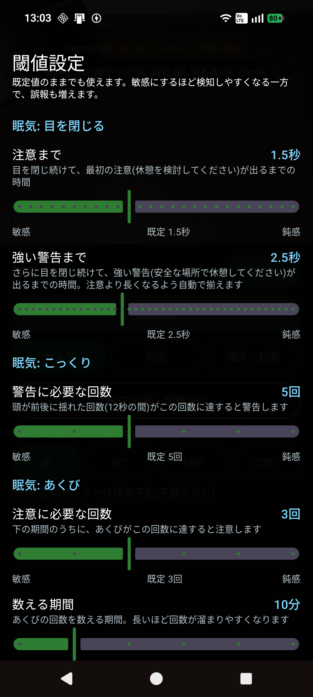

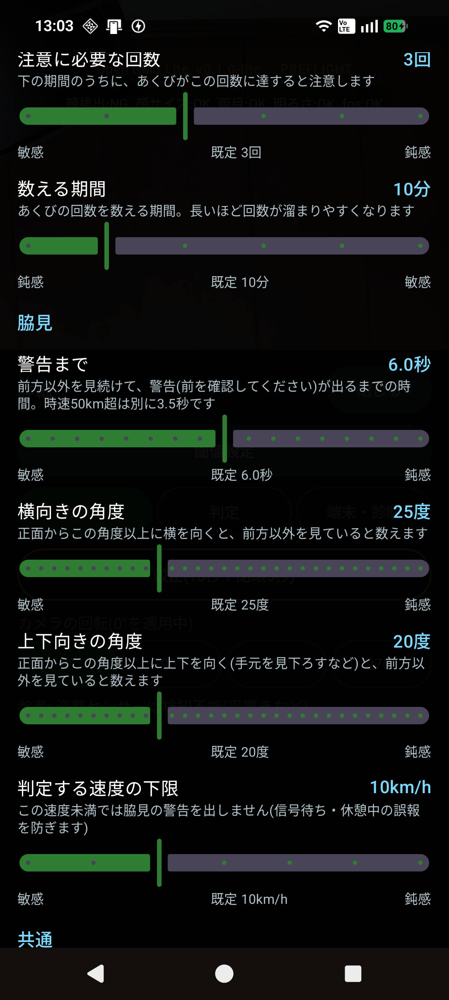

- 敏感にするほど、検知しやすくなる一方で、誤報も増えます。まず既定値のまま使い、必要なときだけ少しずつ動かしてください
- ここに無い項目(顔の大きさ・暗さ・故障検知など)は変えられません

変えられない項目を含む既定値の一覧は [仕様書 §12](SPECIFICATION.md#12-既定値一覧) にあります。

### 8-2. 動作確認モード

停車中や屋内でも脇見を判定するためのスイッチです(通常は時速10km未満で脇見を判定しません)。

- ON の間は紫の帯が常に出ます
- **実際の運行では必ず OFF にしてください**

### 8-3. 警告が出た地点の記録

既定では、走行位置は記録しません。ON にすると、**警告が出た瞬間の1点だけ**を記録します(軌跡は記録しません)。ON にすると、アプリ内「注意事項」の記載も変わります。運転者への説明を済ませてから ON にしてください。

---

## 9. 動作確認の手順(机上)

停車した車内や机の上で、検知の動きを確かめる手順です。

1. 「詳細 → 判定」で**動作確認モードを ON**
2. 較正する(§4-2)
3. 「運行開始」
4. 台本の例
   - 正面を30秒見る
   - 目を10秒閉じる → 「休憩を検討してください」→「安全な場所で休憩してください」
   - **10秒以上あけて**(同じ警告は10秒鳴らないため)もう一度目を閉じる
   - 右を10秒見る → 「前を確認してください」
   - 正面に戻って、左を10秒見る → 「前を確認してください」(右の直後でも鳴ります)
   - 下を10秒見る → 「前を確認してください」
   - 大きなあくびを10分以内に3回 → 「あくびが続いています」
5. 「運行終了」を長押しし、結果画面で警告の一覧を確認
6. **動作確認モードを OFF に戻す**

debug ビルドでは、診断CSV(`/sdcard/Android/data/jp.co.trypro.opendms.lite/files/diagnostics/`)に1フレームごとの値が残るので、後から理由を確認できます。

---

## 10. 記録とデータの扱い

| 記録されるもの | 記録されないもの |
|---|---|
| 警告の種類・時刻・継続時間・その瞬間の速度 | カメラ映像・顔の画像・顔の特徴点 |
| 運行の開始・終了時刻、監視できた時間 | 走行位置(既定。設定で「警告が出た地点」だけ記録するよう変えられます) |

- 記録は端末の中だけに残ります。**ネットワーク通信はしません**
- debug ビルドでは、上に加えて診断CSVが端末に残ります
- アプリを削除すると、記録も消えます

---

## 11. 規格との関係

本アプリは、保安基準・UN-R182/R183 への**適合を保証しません**。項目ごとの対応状況(沿う / 一部 / 非対応)は [対応状況](COMPLIANCE.md) にまとめています。主な点は次のとおりです。

| 項目 | 状況 |
|---|---|
| 眠気・脇見の警告(音・振動・画面) | 国際基準の考え方を参考にした設計(適合は保証しません) |
| 夜間の動作 | **非対応**(夜間・暗所では検知できません)。Full 版(近日リリース予定)は夜間対応カメラで対応します(夜間の実車走行で検証中。§12) |
| 車両との連動(始動での自動復帰・車速) | **非対応**(車速は GPS、作動は「運行開始」の手動操作) |
| 運転者による停止の制限 | **非対応**(アプリを閉じる・閾値を変えるなどで止められます) |
| 規格の試験・効果検証 | **未実施** |

---

<!--pagebreak-->

## 12. Lite と Full の違い

Open DMS Lite は、**近日リリース予定の有償版**「Open DMS Full」の判定・警告の仕組みを、スマートフォンの**インカメラ1台**で使えるようにした無償版です。眠気・脇見の判定、較正、警告、運行の記録は Full 版と同じです。次のような場面では、Full 版がお役に立ちます。

| こんなときは | Full 版でできること |
|---|---|
| 夜間や暗い車内でも見守りたい | 夜間対応カメラ(超高感度センサー または 赤外線LED)で、夜間・暗所の見守りに対応します(夜間の実車走行で検証中) |
| サングラスをかけた運転者も見守りたい | 外付けの赤外線カメラを使うと、主要メーカーの偏光サングラスに対応済みです |
| 運転席に合わせてカメラを置きたい | スマートフォンとは別の外付けカメラ(UVC)を、運転席に合った位置・向きに取り付けられます |
| 2つのカメラで見比べたい | インカメラと外付けカメラ(または外付け2台)を同時に解析します。警告は主カメラ、もう1台は比較・記録に使えます |
| 外付けカメラが外れたときも知りたい | 給電切れ・ケーブル抜けを故障として表示します |
| 停車中に脈拍・ストレスの参考値も知りたい | rPPG(カメラ脈波)で、信号待ちなどの停車中に、脈拍やメンタル/ストレスの参考値をリアルタイムで計算し、ドライバーに通知します(当初はベータ版で提供。医療機器ではなく、眠気・脇見の判定や警告には使いません) |
| 閾値まで細かく調整したい | すべての閾値を調整できます(Lite は10項目) |
| 導入や運用を相談したい | 導入・運用のご相談を受け付けます(§13) |

### 12-1. 機能の比較

| 機能 | Lite | Full |
|---|---|---|
| 眠気の検知(閉眼・こっくり・あくび) | 対応 | 対応 |
| 脇見の検知(速度ゲート・方向ごとの警告間隔・手元と側方の分類) | 対応 | 対応 |
| 顔を見失ったときの扱い・監視不能の表示・故障の表示 | 対応 | 対応 |
| 較正(開眼・閉眼)と、音・振動・画面での警告 | 対応 | 対応 |
| 運行の記録・CSV書き出し | 対応 | 対応 |
| 運行中の表示切替(映像・顔座標・情報のみ)・小窓(PiP) | 対応 | 対応 |
| スマートフォンのインカメラ | 対応 | 対応 |
| 外付けカメラ(UVC) | **非対応** | 対応 |
| 夜間対応カメラ(超高感度センサー または 赤外線LED)での夜間・暗所の見守り | **非対応** | 対応(検証中) |
| サングラス(主要メーカーの偏光サングラス。外付けの赤外線カメラ使用時) | **非対応**(検知できない場合があります) | 対応済み |
| 停車中の脈拍・メンタル/ストレスの参考値(rPPG) | **非対応** | 対応(当初はベータ版) |
| 2台のカメラの同時解析(主カメラ + 比較・記録用) | **非対応** | 対応 |
| 外付けカメラの接続切れ(給電切れ・ケーブル抜け)の故障表示 | — | 対応 |
| 閾値の調整 | 10項目(スライダー) | すべての項目 |
| 導入・運用のご相談 | お問い合わせ | お問い合わせ |
| 提供形態・費用 | 無償。Google Play または弊社サイト・GitHub から入手。ソースは MIT License で GitHub に公開 | 有償・近日リリース予定。**参考予定価格 19,800円〜(税別・カメラ1台込み)**。予定であり、変更することがあります。お問い合わせください |

「対応(検証中)」は、機能は実装済みで、効果の検証が済んでいないことを表します。

### 12-2. 規格との対応の違い

Lite が**未対応**の項目のうち、Full 版が対応するものです。項目ごとの詳しい状況は [対応状況](COMPLIANCE.md) にあります。いずれも、保安基準・UN-R182/R183 への**適合を保証するものではありません**。

| 項目 | Lite | Full |
|---|---|---|
| 夜間・暗所での動作(UN-R182 5.4.1・UN-R183 5.4.1) | **非対応** | 対応(夜間対応カメラ。夜間の実車走行で検証中) |
| 夜間も視認できる視覚警告(UN-R183 5.6) | 一部(夜間の運用が対象外) | 対応(検証中) |
| カメラの接続切れの故障表示 | —(外付けカメラなし) | 対応 |

次の項目は、Lite も Full も**非対応**です(後付けのスマートフォンアプリのため)。

- 車両の始動・車速との連動
- 運転者がシステムを止められないようにする制限
- 規格の試験・効果検証

### 12-3. Full 版をお考えの方へ

- Lite と Full は**別のアプリ**で、同じスマートフォンに両方入れられます
- 画面・操作はほぼ同じです。Lite を使えている方は、すぐに使い始められます
- Lite で「夜間も使いたい」「外付けカメラを使いたい」と感じたときが、Full 版をご検討いただくタイミングです
- Full 版は**近日リリース予定の有償版**です。**参考予定価格は 19,800円〜**(税別・外付けカメラ1台込み)で、予定であり、変更することがあります
- 提供形態や費用など、Full 版のご相談は、§13 の窓口へお問い合わせください

---

<!--pagebreak-->

## 13. お問い合わせ・不具合報告

前検査の画面の「このアプリについて」で、提供元・問い合わせ先・アプリのバージョン(ビルド日時・gitコミットを含む)と、含めているソフトウェアのライセンスを確認できます。不具合報告のときは、ここに出るバージョンをお知らせください。

| 内容 | 窓口 |
|---|---|
| Full 版のご相談(導入・運用・提供形態・費用) | メール: info@trypro.co.jp / 電話: 042-306-2924 |
| スマートフォンのご用意(中古・新品 18,000円〜・税別、設定して納品) | 同じ窓口 |
| 不具合の報告 | 同じ窓口 |
| ご意見・機能のご要望 | 同じ窓口 |

**不具合を報告するときは、次を添えてください。**

- アプリの版(画面上部の「Open DMS Lite v…」)
- 端末の機種と Android のバージョン
- いつ・何をしたときに起きたか、画面に出た文言
- 毎回起きるか、たまに起きるか
- **顔の写った画像・動画は送らないでください**(個人情報です)。画面の撮影が必要なときは、顔が写らない画面だけにしてください

本アプリは無償・無保証で提供しています([免責事項](../DISCLAIMER.md))。ご報告への返信・修正をお約束するものではありません。

---

## 14. 用語

| 用語 | 意味 |
|---|---|
| 較正 | 運転姿勢と目の開き具合をアプリに覚えさせる操作 |
| 運行 | 「運行開始」から「運行終了」まで |
| 脇見 | 前方以外を長く見ていること |
| こっくり | 眠気で頭が前後に揺れる動き |
| 監視不能 | 顔が映らず、判定できない状態(アプリは動いている) |
| 故障 | カメラや解析そのものが動いていない状態 |
| 動作確認モード | 停車中でも脇見を判定する、確認用のスイッチ |

<!--pagebreak-->

## 発行元・お問い合わせ

| | |
|---|---|
| 社名 | 株式会社トライプロ |
| 所在地 | 〒189-0001 東京都東村山市秋津町5-25-95 2F |
| 電話番号 | 042-306-2924 |
| FAX番号 | 050-3488-7454 |
| E-mail | info@trypro.co.jp |
| URL | https://www.trypro.co.jp/ |

お問い合わせ・不具合報告は、上記へお願いします。

---

© 2026 tryproinc  |  Open DMS Lite 取扱説明書  |  お問い合わせ・不具合報告: info@trypro.co.jp / 042-306-2924
